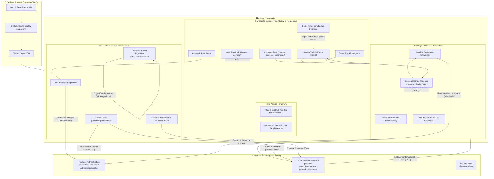
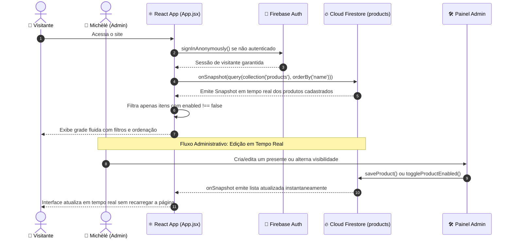

# 🏛️ Arquitetura do Sistema — Jardim dos Presentes de Michèlé Joohann

## 1. Visão Geral do Sistema

O **Jardim dos Presentes** é uma aplicação web moderna, responsiva e acolhedora que transforma uma lista de desejos em uma experiência visual rica inspirada em um *Herbarium Botânico Vitoriano*. Construída sobre **React 19**, **Vite 7** e **Firebase 12**, a aplicação oferece:

- **100% Cloud Firestore como Fonte Única da Verdade**: Nenhum dado de produto é armazenado no código-fonte ou em arquivos estáticos da aplicação. Todo o catálogo reside e é atualizado dinamicamente no banco de dados.
- **Painel Gerencial Completo**: Interface administrativa com autenticação segura, permitindo criação de novos presentes, edição, exclusão, controle de visibilidade (habilitado/desabilitado) e sugestões inteligentes de textos acolhedores, prioridades, sonhos e histórias.
- **Backup & Restauração Sob Demanda**: Ferramenta de exportação e importação de backups em formato JSON diretamente pelo navegador, mantendo o repositório 100% limpo e desacoplado dos dados.
- **Navegação Superior Fixa & Filtros Unificados**: Barra de navegação `sticky` com efeito *glassmorphism* botânico sempre acessível durante a rolagem. Concentra o logotipo da marca com rolagem suave ao topo (`window.scrollTo`), botão circular de filtros com badge numérico em ouro antigo indicando filtros ativos, busca retrátil e acesso administrativo. A vitrine permanece limpa e sem barras redundantes de chips.
- **Filtragem Reativa Multi-Coleção**: Menus flutuantes no desktop e gaveta suspensa tátil no celular com contadores de itens em tempo real (`categoryCounts`), seleção cumulativa (múltiplas coleções simultâneas), alternância para desselecionar e contagem de filtros ativos.
- **Controle de Histórico no Celular (`popstate`)**: Sincronização da pilha de histórico do navegador (`window.history.pushState` / `popstate`) com o modal de presentes (`GiftModal`) e gaveta de filtros. Ao pressionar o botão físico "Voltar" ou realizar o gesto de swipe no celular, a janela/gaveta é fechada e o visitante permanece exatamente no catálogo, sem sair do site.
- **Links Diretos para Lojas Oficiais**: Botões e links contextuais com ícone de link (`🔗`) para compra direta na loja oficial (abertos com segurança em nova aba via `target="_blank"` e `rel="noopener noreferrer"`).
- **Tela de Login Administrativa 100% Responsiva**: Interface de acesso restrito com hierarquia vertical, inputs empilhados de largura total (touch-friendly) e cartão centralizado adaptável para qualquer resolução móvel ou desktop.
- **Code-Splitting e Otimização**: Chunks otimizados no Vite com vendor splitting (`vendor-react`, `vendor-firebase`) e carregamento sob demanda (`lazy` + `Suspense`).

---

## 2. Diagrama Arquitetural Geral



---

## 3. Ciclo de Vida dos Dados e Sincronização em Tempo Real

A arquitetura adota o **Cloud Firestore como Fonte Única e Exclusiva da Verdade**:



---

## 4. Estrutura de Diretórios Atual

```text
JardimDosPresentes/
├── .github/
│   └── workflows/
│       └── deploy-pages.yml          # CI/CD: build e deploy automático no GitHub Pages
├── docs/
│   ├── ARCHITECTURE.md               # Este documento de arquitetura e decisões técnicas
│   ├── FIREBASE_SETUP.md             # Guia de configuração do Firebase Console
│   ├── INITIAL_MIGRATION.md          # Histórico da migração inicial
│   └── PRODUCT_BACKLOG.md            # Histórico de requisitos e melhorias
├── public/
│   ├── favicon.svg                   # Ícone oficial do site
│   └── images/                       # Ilustrações botânicas vetoriais e logotipo MJ
├── src/
│   ├── components/
│   │   ├── AdminMigrationPanel.jsx   # Painel de gestão da Michèlé (CRUD, recados e backup)
│   │   ├── GiftModal.jsx             # Modal interativo de presente com dedicatória
│   │   ├── ProductCard.jsx           # Card editorial de presente (status, tags, sonho e links)
│   │   └── ProductEditorModal.jsx    # Modal de criação/edição com motor de sugestões
│   ├── firebase/
│   │   └── config.js                 # Inicialização do Firebase (Auth, Firestore, Storage)
│   ├── services/
│   │   ├── giftSuggestions.js        # Motor de sugestões contextuais (histórias, prioridades, sonhos)
│   │   ├── productService.js         # Serviço de persistência, alternância e exclusão no Firestore
│   │   └── reservationService.js     # Serviço de reservas públicas e privadas no Firestore
│   ├── styles/
│   │   └── global.css                # Folha de estilos Herbarium Vitoriano e responsividade
│   ├── App.jsx                       # Componente raiz: topo, busca, hero, filtros reativos e catálogo
│   └── main.jsx                      # Ponto de entrada React 19
├── firestore.rules                   # Regras de segurança do Cloud Firestore
├── index.html                        # Template HTML com meta tags SEO e viewport
├── package.json                      # Dependências do projeto (React 19, Vite 7, Firebase 12)
├── vite.config.js                    # Configuração Vite com base URL e code-splitting
└── README.md                         # Documentação central do projeto
```

---

## 5. Dicionário de Dados (`products/{productId}`)

Cada documento na coleção `products` do Cloud Firestore possui a seguinte estrutura oficial:

| Campo | Tipo | Descrição | Exemplo |
|---|---|---|---|
| `id` | `string` | Identificador único e legível (slug) | `"asas-de-fada-luxo-01"` |
| `name` | `string` | Nome carinhoso e comercial do produto | `"Asas de Fada / Borboleta em Tecido"` |
| `category` | `string` | Categoria principal (Coleção) | `"moda"`, `"casa"`, `"arte"`, `"joias"` |
| `subcategory` | `string` | Canteiro / Subcategoria | `"acessorios"`, `"fantasia"`, `"decoracao"` |
| `collection` | `string` | Coleção temática do Jardim | `"Magia das Fadas"`, `"Herbarium"` |
| `price` | `number \| null` | Valor numérico de referência | `89.90` |
| `priceLabel` | `string` | Formatação em moeda amigável | `"R$ 89,90"`, `"Consultar na loja"` |
| `priority` | `string` | Nível de prioridade / importância | `"alta"`, `"media"`, `"baixa"` |
| `enabled` | `boolean` | Flag de visibilidade ativa no site | `true` (visível) ou `false` (oculto) |
| `published` | `boolean` | Espelhamento de visibilidade para compatibilidade | `true` ou `false` |
| `visible` | `boolean` | Espelhamento de visibilidade para compatibilidade | `true` ou `false` |
| `imageUrl` | `string` | URL direta da fotografia principal | `"https://..."` |
| `url` | `string` | Link direto para a loja onde comprar | `"https://..."` |
| `store` | `string` | Nome da loja fornecedora | `"SHEIN"`, `"Amazon"`, `"Ateliê"` |
| `description` | `string` | Descrição técnica ou estética do item | `"Asas artesanais em organza furta-cor..."` |
| `dream` | `string` | O sonho ou intenção associada ao presente | `"Incorporar o espírito das fadas e a leveza..."` |
| `story` | `string` | História de carinho ou memória conectada | `"Desde a infância o fascínio por asas e seres mágicos..."` |
| `meanings` | `string[]` | Tags simbólicas de significado | `["Liberdade", "Magia", "Sonho"]` |
| `sizes` | `string[]` | Tamanhos ou especificações | `["Único", "Ajustável"]` |
| `notes` | `string[]` | Observações adicionais | `["Preferência por tons translúcidos"]` |
| `quantityDesired` | `number` | Quantidade almejada | `1` |
| `quantityReceived` | `number` | Quantidade já conquistada / florescida | `0` |
| `status` | `string` | Estado calculado ou atribuído | `"available"`, `"reserved"`, `"received"` |
| `createdAt` | `timestamp` | Data de criação no Firestore | `ServerTimestamp` |
| `updatedAt` | `timestamp` | Data da última alteração no Firestore | `ServerTimestamp` |

---

## 6. Segurança e Regras de Controle de Acesso

As regras declaradas em `firestore.rules` asseguram:

1. **Leitura Pública**: Qualquer visitante (anônimo ou autenticado) pode consultar a coleção `products` e a coleção `publicReservations`.
2. **Escrita Administrativa Exclusiva**: Apenas a conta autenticada correspondente ao `ADMIN_UID` (`7G4v3hEMtaVzI8MUDsXjVCNXGJz1`) possui permissão para executar `create`, `update` ou `delete` na coleção `products`.
3. **Privacidade das Dedicatórias**: A coleção `privateReservations` (que guarda nomes, e-mails e mensagens confidenciais dos convidados) pode ser criada por qualquer visitante no momento do presente, mas **somente a administradora autenticada pode ler e listar** as mensagens.
4. **Isolamento de Código**: Nenhum dado confidencial ou lista de produtos estática trafega no repositório. O banco de dados é a autoridade máxima e única.
---

## 7. Arquitetura de Navegação Mobile & Controle de Histórico (`popstate`)

Em aplicações de página única (SPA), abrir modais ou gavetas sem atualizar a pilha de histórico do navegador faz com que o botão "Voltar" (físico ou por gesto no Android e iOS) feche a aba ou saia do site. Para proporcionar uma experiência verdadeiramente nativa, a aplicação implementa **sincronização de histórico atômica**:

1. **Empilhamento de Estado (`pushState`)**:
   - Ao abrir o modal de presente (`giftingProduct`) ou a gaveta de filtros (`mobileMenuOpen`), um identificador único com carimbo temporal (`gift-modal-${Date.now()}` / `filters-drawer-${Date.now()}`) é inserido no histórico via `window.history.pushState`.
2. **Interceptação do Evento `popstate`**:
   - Um listener dedicado escuta o evento `popstate`. Se disparado pelo gesto de voltar ou botão físico do dispositivo, a flag `isClosingByPopstateRef` é ativada e o modal/gaveta é fechado imediatamente.
   - O usuário permanece **exatamente na mesma altura de rolagem do catálogo**, sem qualquer salto visual ou recarregamento.
3. **Fechamento Programático Seguro**:
   - Caso o usuário feche a interface via botão **✕**, clique no backdrop, botão **Cancelar**, tecla **ESC** ou conclusão do fluxo ("Voltar ao Jardim"), a rotina de limpeza do efeito verifica se o estado ativo do histórico ainda pertence ao modal (`window.history.state?.modalKey === modalKey`) e executa `window.history.back()`.
   - Essa verificação impede o acúmulo de entradas órfãs na pilha de navegação, mantendo o histórico sempre limpo.

---

## 8. Sistema de Filtros Reativo & Multi-Coleção na Barra Superior

1. **Unificação na Barra Superior**:
   - Os controles de filtragem e busca estão integrados à barra superior fixa (`.site-top-bar`), eliminando barras secundárias ou faixas de chips redundantes sobre o catálogo e maximizando a área útil da vitrine.
2. **Seleção Cumulativa**:
   - O estado `selectedCategories` aceita um array de coleções (`[]`). Quando múltiplas coleções são selecionadas, o catálogo exibe qualquer presente pertencente a pelo menos uma das coleções ativas (`selectedCategories.includes(product.category)`).
3. **Alternância para Desselecionar**:
   - Clicar em uma categoria já selecionada a desativa. Quando a última categoria for desmarcada, a aplicação retorna automaticamente ao estado de "Todas as coleções".
4. **Contadores Dinâmicos de Itens**:
   - Um `useMemo` dedicado calcula em tempo real o número de presentes disponíveis para cada coleção (`categoryCounts`), exibindo `Coleção (N)` nos menus suspensos e na gaveta mobile.
5. **Indicador Visual na Barra Superior**:
   - O botão de filtro na barra superior exibe um badge numérico (`.top-filter-count-badge`) dourado sempre que houver 1 ou mais filtros aplicados, e a gaveta mobile oferece botão direto de "Limpar".

---

## 9. Arquitetura e Responsividade da Tela de Login Administrativo

Para garantir acessibilidade ergonômica total em smartphones e telas estreitas:

1. **Card Centralizado e Focado**:
   - O componente `.admin-panel-login` utiliza layout vertical centrado com `max-width: 440px` e largura flexível `100%`, prevenindo colisões ou sobreposição de colunas em telas de qualquer tamanho.
2. **Hierarquia Vertical Fluida**:
   - **Cabeçalho**: Selo heráldico circular MJ centralizado, acompanhado do kicker em borgonha e título com tipografia clássica serifada.
   - **Formulário**: Inputs de e-mail e senha empilhados verticalmente com altura mínima de toque (`min-height: 48px`), preenchimento confortável e largura de 100%.
   - **Ações**: Botão primário de submissão com gradiente botânico e botão secundário inferior para retorno seguro à vitrine pública.


